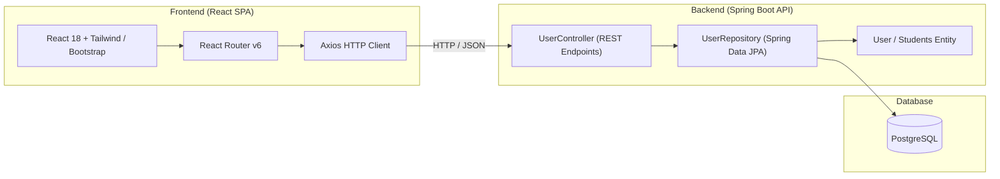

# Student Tracker

A full-stack CRUD web application for managing student records, built with **React** on the frontend and **Spring Boot** on the backend, backed by **PostgreSQL**.

---

## Architecture Overview



---

## Features

- **Full CRUD Capabilities**: Create, read, update, and delete student records with instant UI feedback.
- **Dynamic Physical Characteristics Visualization**: The student detail modal dynamically scales a visual box according to height and weight, with border accents mapped to hair color.
- **Password Privacy Toggle**: Obfuscated passwords in table views with toggleable visibility for improved security and privacy.
- **Input Validation**: Client-side validation ensuring valid GPA ranges ($0.00$ to $4.50$) and metric boundaries.
- **Responsive UI**: Built with Material Tailwind, Bootstrap 5, and Tailwind CSS for mobile and desktop screens.
- **RESTful API**: Standardized JSON REST API with global exception handling (`@ControllerAdvice`).
- **Containerized**: Production-ready multi-stage `Dockerfile` for streamlined container deployment.

---

## Tech Stack

### Frontend
- **Framework**: React 18
- **Routing**: React Router v6
- **UI & Styling**: Material Tailwind, Tailwind CSS, Bootstrap 5, React-Bootstrap, React-Bootstrap Icons
- **HTTP Client**: Axios

### Backend
- **Framework**: Spring Boot 3.1.0
- **Language**: Java 17
- **Data & ORM**: Spring Data JPA, Hibernate
- **Database**: PostgreSQL
- **Build Tool**: Maven

---

## API Endpoints

| Method | Endpoint | Description |
| :--- | :--- | :--- |
| `POST` | `/student` | Create a new student |
| `POST` | `/admin/login` | Admin login (username & password) |
| `POST` | `/teacher/login` | Faculty / Teacher login with email & password |
| `POST` | `/student/login` | Student login with email & password |
| `GET` | `/teachers` | List all faculty members (Admin only) |
| `POST` | `/teacher` | Register new faculty member (Admin only) |
| `PUT` | `/teacher/{id}` | Update faculty details (Admin only) |
| `DELETE` | `/teacher/{id}` | Remove faculty member (Admin only) |
| `PUT` | `/course/{courseId}/assign-teacher/{teacherId}` | Assign faculty member to subject (Admin only) |
| `GET` | `/teacher/{id}/courses` | Get subjects taught by faculty member (Self or Admin) |
| `GET` | `/teacher/course/{courseId}/students` | Get enrolled students for assigned subject (Assigned Faculty or Admin) |
| `PUT` | `/teacher/enrollment/{enrollmentId}/marks` | Enter internal marks, exam marks, grade, attendance (Assigned Faculty only) |
| `GET` | `/students` | Get all students (Admin only) |
| `GET` | `/student/{id}` | Get student details by ID |
| `PUT` | `/student/{id}` | Update existing student |
| `DELETE` | `/student/{id}` | Delete a student by ID |
| `POST` | `/student/{id}/photo` | Upload student profile photo (multipart/form-data) |
| `GET` | `/student/{id}/photo` | Retrieve student profile photo image |
| `DELETE` | `/student/{id}/photo` | Remove student profile photo |
| `GET` | `/courses` | List all available academic courses |
| `POST` | `/course` | Create a new course (Admin only) |
| `DELETE` | `/course/{id}` | Delete a course (Admin only) |
| `POST` | `/student/{id}/enroll/{courseId}` | Enroll student in an academic subject |
| `DELETE` | `/student/{id}/enroll/{courseId}` | Drop an enrolled course |
| `GET` | `/student/{id}/courses` | Get student's enrolled courses, marks, grades & attendance |
| `PUT` | `/enrollment/{id}/grade` | Assign grade, marks & attendance, auto-recalculating student GPA (Admin only) |

---

## Getting Started

### Prerequisites
- **Java 17+**
- **Node.js 18+** & **npm**
- **PostgreSQL** (or Docker)

---

### Backend Setup

1. Navigate to the backend directory:
   ```bash
   cd student-tracker-backend
   ```

2. Configure environment variables (optional — defaults to local PostgreSQL):
   ```bash
   export DB_URL=jdbc:postgresql://localhost:5432/student_tracker
   export DB_USERNAME=postgres
   export DB_PASSWORD=postgres
   ```

3. Build and run the Spring Boot application:
   ```bash
   ./mvnw spring-boot:run
   ```
   The backend service starts at `http://localhost:8080`.

---

### Frontend Setup

1. Navigate to the frontend directory:
   ```bash
   cd student-tracker-frontend
   ```

2. Copy the example environment file:
   ```bash
   cp .env.example .env
   ```

3. Install dependencies and start the development server:
   ```bash
   npm install
   npm start
   ```
   The frontend application starts at `http://localhost:3000`.

---

### Default User Roles & Credentials

| Role | Username / Email | Password | Access Scope |
| :--- | :--- | :--- | :--- |
| **Admin** | `admin` | `admin123` | Master control: manage students, add faculty, allocate subjects |
| **Faculty (CS101)** | `knuth@university.edu` | `teacher123` | Subject-restricted: manage marks & grades for *CS101* |
| **Faculty (CS201)** | `codd@university.edu` | `teacher123` | Subject-restricted: manage marks & grades for *CS201* |
| **Faculty (MATH102)**| `strang@university.edu` | `teacher123` | Subject-restricted: manage marks & grades for *MATH102* |
| **Faculty (PHY101)** | `feynman@university.edu` | `teacher123` | Subject-restricted: manage marks & grades for *PHY101* |
| **Faculty (ENG205)** | `atwood@university.edu` | `teacher123` | Subject-restricted: manage marks & grades for *ENG205* |
| **Student** | `athulkrishnams027@gmail.com` | `12345678` | Private profile: enroll in courses, view own marks & ID card |

---

### Docker Deployment

To build and run the backend container:

```bash
cd student-tracker-backend
docker build -t student-tracker-backend .
docker run -p 8080:8080 -e DB_URL=jdbc:postgresql://host.docker.internal:5432/student_tracker student-tracker-backend
```

---

## Project Structure

```
Student-Tracker/
├── student-tracker-backend/
│   ├── src/
│   │   ├── main/java/com/studenttrackercurd/studenttrackerbackend/
│   │   │   ├── Controller/          # REST Controllers
│   │   │   ├── Exception/           # Custom exceptions & advice
│   │   │   ├── Model/               # JPA Entities
│   │   │   └── Repository/          # Spring Data JPA Repositories
│   │   └── main/resources/          # Application properties
│   ├── Dockerfile                   # Multi-stage Docker build
│   └── pom.xml                      # Maven dependencies
├── student-tracker-frontend/
│   ├── public/                      # Static assets & HTML template
│   ├── src/
│   │   ├── components/              # UI & Form components
│   │   ├── pages/                   # Page views (Home)
│   │   ├── App.js                   # Route definitions
│   │   └── index.js                 # React entry point
│   ├── package.json                 # Frontend dependencies & scripts
│   └── tailwind.config.js           # Tailwind CSS configuration
├── .gitignore                       # Repository-wide ignore rules
└── README.md                        # Documentation
```
